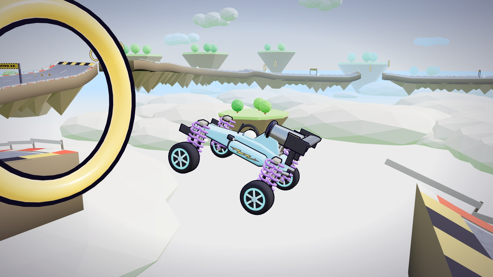

# Гаечный Гран-при

Мультяшные 3D-гонки на машинах-конструкторах: сборка машины из деталей, тюнинг, 19 трасс, полеты на нитро.

**Играть:** https://bertik3008.github.io/gaechny-gran-pri/

## Установка на iPhone
1. Открыть ссылку в Safari.
2. Нажать «Поделиться», затем «На экран Домой».
3. Запускать игру с иконки: она откроется на весь экран без панелей браузера. Играть в горизонтальном положении.

Управление на телефоне - кнопки на экране, на компьютере - стрелки или WASD, нитро - Shift.
